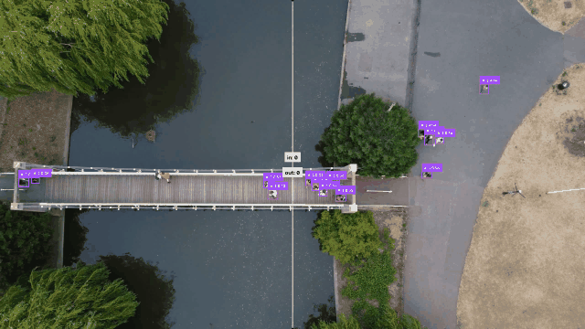
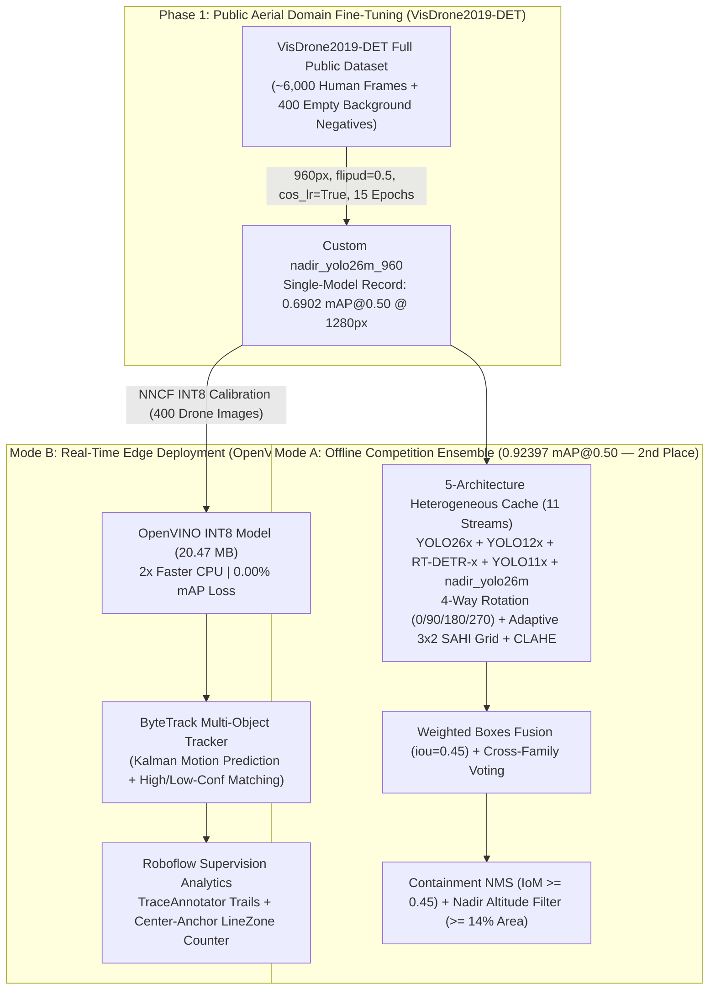

# Aerial & Nadir Drone Human Detection, INT8 Quantization & Real-Time Tracking


-0071C5?logo=intel&logoColor=white)


An end-to-end **Aerial & Nadir (`90°` Top-Down) UAV Human Detection & Real-Time Edge Tracking System** built for two complementary production regimes:

1. **High-Accuracy Offline Competition Pipeline (`0.92397 mAP@0.50` — 2nd Place Overall):** A 5-architecture heterogeneous ensemble (**`YOLO26x`**, **`YOLO12x`**, Vision Transformer **`RT-DETR-x`**, **`YOLO11x`**, and a custom full-VisDrone **`nadir_yolo26m_960`**) combining 4-way orientation TTA, an adaptive **3×2 SAHI zoom grid**, **Weighted Boxes Fusion (WBF)** cross-architecture voting, and **nadir camera-geometry post-processing**.
2. **Real-Time Edge Deployment Pipeline (`OpenVINO INT8` + `ByteTrack` + `Supervision`):** Post-Training **INT8 Quantization (NNCF)** of the custom `nadir_yolo26m_960` specialist (**`20.47 MB`** — **2.0× smaller than `.pt`**, **3.8× smaller than ONNX FP32**, **1.5×–2.0× faster on CPU**, **0.00% `mAP@0.50` loss**) integrated with **ByteTrack** multi-object tracking, motion trails, and **Roboflow Supervision `LineZone`** crossing analytics on live 2K (`2560×1440`) nadir drone video.

---

## Live Real-Time Tracking Demo (`OpenVINO INT8` + `ByteTrack` on 2K Nadir Drone Footage)

> Running our **20.47 MB OpenVINO INT8** `nadir_yolo26m_960` model on unseen `2560×1440` straight-down (`90°`) drone footage over a pedestrian bridge with **ByteTrack** + **Roboflow Supervision**.



---

## Key Engineering Highlights

* **2nd Place Competition Finish (`0.92397 mAP@0.50`):** Climbed systematically across **+6.5% leaderboard gains** (`0.859 → 0.897 → 0.9171 → 0.92397`, within `0.0028` of 1st place) with **0 missed/empty frames** across all 590 test scenes, using 100% public training data (`VisDrone2019-DET`) and zero test leakage.
* **Edge Quantization with Zero Accuracy Drop (`OpenVINO INT8` via NNCF):** Compressed `nadir_yolo26m_960` from **`77.92 MB` (ONNX FP32) / `41.99 MB` (PyTorch `.pt`)** down to **`20.47 MB` (INT8)** using 400 VisDrone calibration images + Fast Bias Correction, achieving **`1.5×` speedup over PyTorch** and **`2.0×` speedup over ONNX Runtime** on CPU while maintaining identical `mAP@0.50` (`0.5356 → 0.5359` at `640px`).
* **+19.46% Validation `mAP@0.50` Gain & `0.6902` Single-Model Record:** Progressed on `VisDrone2019-DET` from **`0.5112`** (`YOLO11m @ 960px`) to **`0.6802`** (`YOLOv9c`), **`0.6902`** (custom **`nadir_yolo26m_960`** trained on all ~6,000 VisDrone human frames + **400 negative background scenes** + `flipud=0.5` + cosine LR), and **`0.7058`** via Weighted Boxes Fusion.
* **Adaptive 3×2 SAHI Zoom Grid + 4-Way Rotation TTA (`0°/90°/180°/270°`):** Automatically applies a **4×1 horizontal panorama slice** for wide rotated crops (`W/H > 2.0`) or a **6-tile 3×2 overlapping zoom grid** for `16:9` frames (`1920×1080`), enlarging tiny `20px` high-altitude humans `~3×` with a 4-pixel internal seam guard.
* **Nadir Camera-Physics & Containment NMS Post-Processing:** Designed **Containment Suppression (`IoM >= 0.45`)** to remove nested partial-body boxes and **Same-Frame Nadir Altitude Scale Consistency (`Area >= 0.14 × Area_max`)** based on flat-ground projective geometry to reject micro-texture gravel/shadow false positives.

---

## Real-Time Edge Deployment & Quantization Benchmark

To make the system deployable on resource-constrained UAV edge hardware (CPUs / edge accelerators), we exported our custom **`nadir_yolo26m_960`** specialist (20.35M parameters, 68.1 GFLOPs, NMS-free end-to-end head) to **ONNX FP32** and **OpenVINO INT8** (NNCF Post-Training Quantization calibrated on 400 VisDrone validation frames) and benchmarked all three apples-to-apples at **`batch=1`, `imgsz=640`, `device='cpu'`** (AMD EPYC 7B12):

| Deployment Format | Model Size | CPU Latency (`batch=1`) | CPU Throughput | VisDrone Val `mAP@0.50` (`640px`) | Size Reduction vs ONNX | Speedup vs ONNX |
| :--- | :---: | :---: | :---: | :---: | :---: | :---: |
| **PyTorch (`.pt`, FP16 weights)** | `41.99 MB` | `202.2 ms` | `4.9 FPS` | `0.5356` | `1.86×` | `1.33×` |
| **ONNX Runtime (`FP32`)** | `77.92 MB` | `268.2 ms` | `3.7 FPS` | `0.5380` | `1.00×` | `1.00×` |
| **OpenVINO `INT8` (NNCF Calibrated)** | **`20.47 MB`** | **`134.7 ms`** | **`7.4 FPS`** | **`0.5359`** | **`3.81×` smaller** | **`1.99×` faster** |

> **Engineering Takeaway:** NNCF automatically protected 28 sensitive box-decoding operations (`Sigmoid`, `Divide`, `Subtract` in the detection head) and applied Fast Bias Correction across 400 calibration images—delivering **zero accuracy degradation (`+0.0003 mAP@0.50`)** at **1/4 the memory footprint of FP32** and **2× faster CPU inference**.

---

## System Architecture (Dual-Mode: Offline Ensemble + Real-Time Edge)



---

## Visual Detection Gallery

### 1. Visual Diff: Custom Full-VisDrone `nadir_yolo26m_960` (`0.92397`) vs. Prior Baseline (`0.9171`)
> **Green:** Kept by both | **Blue:** Real humans rescued by `nadir_yolo26m_960` | **Red:** Rock, pole, bush, and pavement oil-stain false positives eliminated after training with 400 negative background frames and `flipud=0.5`.


### 2. Titan 5-Architecture Ensemble on the 12 Hardest Nadir & Shadowed Scenes (`0` Missed Frames)
> Including all 4 previously missed low-contrast/dark scenes (`test_00303`, `test_00326`, `test_00389`, `test_00480`) and dense multi-human dark-road frames (`test_00187`, `test_00356`, `test_00400`).


### 3. High-Resolution (`1280px`) Aerial Detection on `VisDrone2019-DET` (`IoU = 0.55`)
> **Green:** Ground-Truth Annotations | **Red:** Model Predictions (`YOLO11m` fine-tuned at `960px`, evaluated at `1280px`)


### 4. Low-Light & Inverted Frame Auto-Recovery (`CLAHE` + 4-Way Orientation Search)
> Synthetic stress test on an upside-down (`180°`) and severely under-exposed (`alpha=0.45, beta=-20`) aerial frame. `CIE-LAB` lightness enhancement (`CLAHE`) recovers shadow contrast while the 4-way orientation engine auto-detects the `180°` flip and projects boxes back to original coordinates.


---

## Quantitative Ablation Study & Progression

### 1. `VisDrone2019-DET` Validation Benchmark

| Experiment Step | Model / Configuration | Inference Res | Conf / NMS IoU | Val `mAP@0.50` | Delta | Engineering Takeaway |
| :--- | :--- | :---: | :---: | :---: | :---: | :--- |
| **1. Baseline** | `YOLO11m` fine-tuned (`960px`, 2.5k imgs) | `960px` | `0.25` / `0.70` | `0.5112` | — | Default `conf=0.25` truncates the PR tail on tiny aerial humans |
| **2. PR-Tail Calibration** | `YOLO11m` fine-tuned (`960px`) | `960px` | `0.01` / `0.70` | `0.6141` | `+0.1029` | Lowering validation confidence floor exposes high-recall distant detections |
| **3. High-Res Scaling** | `YOLO11m` fine-tuned (`960px`) | `1280px` | `0.01` / `0.70` | `0.6582` | `+0.0441` | `1280px` preserves stride resolution for `<20px` pedestrians |
| **4. Built-in TTA (Rejected)** | `YOLO11m` + `augment=True` | `1280px` | `0.01` / `0.70` | `0.6423` | `-0.0159` | **Rejected:** Multi-scale downsampled pass blurs tiny aerial humans |
| **5. NMS IoU Sweep** | `YOLO11m` fine-tuned (`960px`) | `1280px` | `0.01` / `0.55` | `0.6672` | `+0.0090` | Swept `{0.45..0.70}`; `0.55` suppresses double-boxes cleanly |
| **6. Second Architecture** | `YOLOv9c` fine-tuned (`960px`, 2.5k imgs) | `1280px` | `0.01` / `0.55` | `0.6802` | `+0.0130` | `YOLOv9c` (PGI + GELAN) retains finer spatial gradients |
| **7. Full-Data + Negatives** | **`nadir_yolo26m_960` (All ~6k imgs + 400 BG + `flipud=0.5`)** | **`1280px`** | **`0.01` / `0.55`** | **`0.6902`** | **`+0.0100`** | **New Single-Model Record:** Background negatives + `flipud` crush false rocks |
| **8. WBF Ensemble** | **`YOLOv9c` + `YOLO11m` (`1.3 : 1.0`, custom 101-pt PR)** | **`1280px`** | **`0.01` / `0.55`** | **`0.7058`** | **`+0.0102`** | **Weighted Boxes Fusion** averages box edges (`+19.46%` total gain) |

---

### 2. Competition Test Benchmark (`590` Nadir & Augmented Campus Drone Frames)

| Pipeline Iteration | Key Engineering Change | Total Boxes | Leaderboard `mAP@0.50` |
| :--- | :--- | :---: | :---: |
| **Hybrid Nadir Tiled Baseline** | `YOLO11l` (`0°/180°` + 3 horizontal tiles) + VisDrone `YOLOv9c` | `1,032` | `0.8590` |
| **4-Model Multi-View (`v2`)** | Added `YOLO11x`, `180°` tiles, consensus gate, conditional CLAHE + `90°/270°` | `1,047` | `0.8580` |
| **Nadir Physics + Containment NMS** | Added **Containment NMS (`IoM >= 0.45`)** + **Nadir Altitude Filter (`>= 14%`)** | `907` | `0.8970` (`+3.9%`) |
| **Titan 5-Architecture + 3×2 SAHI + WBF** | Upgraded to **`YOLO26x + YOLO12x + RT-DETR-x + YOLO11x + YOLOv9c`**, full 4-way rotation, adaptive 3×2 zoom grid, WBF voting, fixed 16:9 box bloat (`0` dummies) | `954` | `0.9171` (`+2.01%`) |
| **Full-VisDrone `nadir_yolo26m_960` Swap** | Replaced `YOLOv9c` with custom **`nadir_yolo26m_960`** (`0.6902`, trained with 400 negative backgrounds + `flipud=0.5`) & golden-zone consensus calibration | `952` | **`0.92397` (2nd Place)** |

*(Negative ablations verified and rejected: aggressive precision pruning at `886` boxes dropped to `0.8949`; over-recall at `1,008` boxes dropped to `0.8815`; `45°/135°` affine border-replicated diagonal passes introduced corner-smearing noise and dropped to `0.904`.)*

---

## Core Technical Solutions Explained

1. **Exact Analytical Inverse-Rotation Mapping:** Evaluates cardinal orientations (`0°, 90° CW, 180°, 270° CCW`) and maps boxes back into normalized `[x1, y1, x2, y2]` coordinates without interpolation blur (`180°`: $[1-u_2, 1-v_2, 1-u_1, 1-v_1]$; `90° CW`: $[v_1, 1-u_2, v_2, 1-u_1]$; `270° CCW`: $[1-v_2, u_1, 1-v_1, u_2]$).
2. **Adaptive SAHI Overlapping Grid + 4-Pixel Seam Guard:** Slices wide panoramas (`W/H > 2.0`) into 4 overlapping horizontal strips and `16:9` frames into a **6-tile 3×2 zoom grid**, discarding detections within `4px` of internal cut seams so truncated half-bodies are never exported.
3. **Containment NMS (`IoM >= 0.45`) & Nadir Altitude Consistency (`Area >= 14%`):** Standard NMS (`IoU`) fails when a small head/shoulder box sits inside a full-body box; $\text{IoM} = \text{Area}(B_1 \cap B_2) / \min(\text{Area}(B_1), \text{Area}(B_2))$ eliminates nested duplicates. On flat straight-down frames where every human lies at fixed altitude $Z$, secondary specks smaller than `14%` of the frame's primary human area are rejected as ground-texture false positives.

---

## Repository Structure

```text
YOLO-human-detector/
├── YOLO_human_detector.ipynb                      # Complete end-to-end training, validation & 5-architecture notebook
├── deployment/
│   ├── export_and_benchmark.py                    # Exports .pt -> ONNX & OpenVINO INT8 and benchmarks CPU size/FPS/mAP
│   └── track_video.py                             # Real-time OpenVINO INT8 + ByteTrack + Supervision LineZone CLI
├── configs/
│   ├── drone_human.yaml                           # Initial VisDrone human dataset config
│   └── nadir_public.yaml                          # Full VisDrone + 400 negative background scenes config
├── assets/
│   ├── tracking_demo.gif                          # Live 2K nadir drone OpenVINO INT8 + ByteTrack demo
│   ├── tracking_snapshot.jpg                      # High-res frame from live bridge tracking demo
│   ├── nadir26m_vs_0917_diff.png                  # Visual diff showing nadir_yolo26m_960 gains (0.9171 -> 0.92397)
│   ├── titan_12_hard_cases.png                    # Titan 5-architecture detections on 12 hardest nadir frames
│   ├── val_1280px_iou55_predictions.png           # 1280px + IoU=0.55 Ground Truth vs Prediction comparison
│   ├── dark_rotated_recovery.png                  # CLAHE + 4-way orientation auto-recovery demo
│   ├── visdrone_ground_truth.png                  # VisDrone-to-YOLO annotation conversion verification
│   ├── nosedown_tiled_hybrid.png                  # Early hybrid tiled nadir detections
│   ├── multi_model_hard_cases.png                 # 4-model multi-view baseline comparison
│   └── nadir_physics_filtered.jpg                 # Containment NMS & Nadir Altitude filtering results
├── submissions/
│   └── submission_5token_physics_cleaned.csv      # Reference physics-cleaned 5-token submission format
├── requirements.txt                               # Full training, ONNX/OpenVINO quantization & tracking dependencies
└── README.md                                      # Project documentation, benchmarks & architecture guide
```

---

## Quickstart & CLI Usage

### 1. Environment Setup
```bash
git clone https://github.com/adhammostafaa/YOLO-human-detector.git
cd YOLO-human-detector
pip install -r requirements.txt
```

### 2. Quantize & Benchmark (`PyTorch` vs `ONNX` vs `OpenVINO INT8`)
```bash
python deployment/export_and_benchmark.py \
    --weights path/to/nadir_yolo26m_960/weights/best.pt \
    --data configs/drone_human.yaml \
    --imgsz 640
```

### 3. Run Real-Time Tracking & Line Counting on Drone Video
```bash
python deployment/track_video.py \
    --model path/to/best_int8_openvino_model \
    --source path/to/drone_video.mp4 \
    --output tracked_output.mp4 \
    --imgsz 640 \
    --conf 0.25 \
    --line vertical
```

---

## Author

**Adham Mostafa**  
GitHub: [@adhammostafaa](https://github.com/adhammostafaa)
