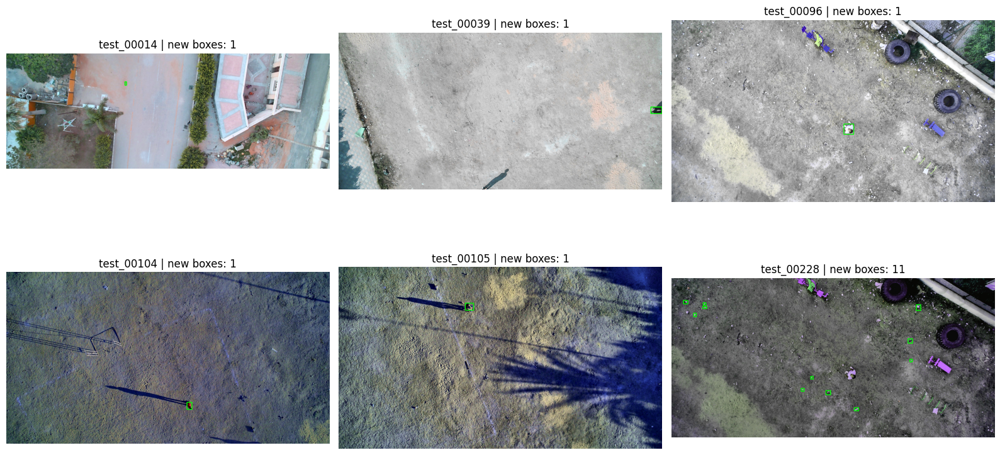
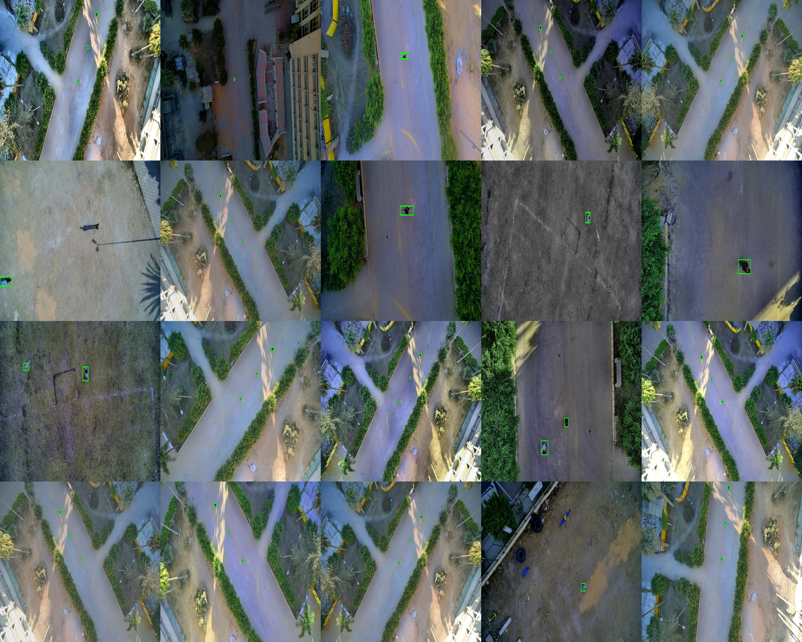
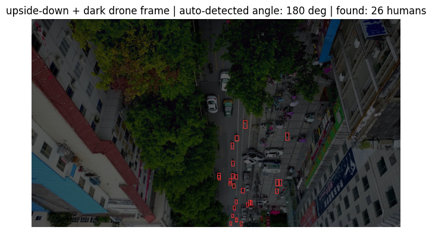

# Aerial & Nadir Drone Human Detection — Multi-Model YOLO Ensemble (`YOLO11` + `YOLOv9`)


-76B900?logo=nvidia&logoColor=white)


An end-to-end **Aerial & Nadir (`90°` Top-Down) Human Detection Pipeline** built for unmanned aerial vehicles (UAVs) operating across extreme altitude variations, arbitrary camera roll angles (`0°–360°`), wide aspect-ratio panorama crops, and low-light shadow conditions.

Developed for the **Alex Eagles AI Subteam — Human Detection Competition**, this system combines **fine-tuned aerial models (`YOLOv9c`, `YOLO11m` trained on `VisDrone2019-DET`)** with **large-scale pretrained feature extractors (`YOLO11x`, `YOLO11l`)**, **overlapping panorama tiling**, **CIE-LAB adaptive contrast recovery (`CLAHE`)**, and **nadir camera-geometry post-processing** to achieve **`0.8970 mAP@0.50`** on the competition benchmark and **`0.7058 mAP@0.50`** (`+19.46%` over baseline) on `VisDrone2019-DET-val`.

---

## Key Engineering Highlights

* **+19.46% Validation `mAP@0.50` Gain via Disciplined Ablations:** Improved `VisDrone2019-DET` human detection accuracy from **`0.5112`** (baseline `YOLO11m @ 960px`) to **`0.7058`** through resolution scaling (`1280px`), PR-curve confidence calibration, NMS IoU tuning (`0.55`), cross-architecture diversity (`YOLOv9c` PGI/GELAN + `YOLO11m` C3k2), and **Weighted Boxes Fusion (WBF)**.
* **6-Stage Multi-View Hybrid Nadir Inference Engine:** Combines full-frame multi-orientation passes (`0°`, `180°`, and conditional `90°`/`270°` rotations) with **3 overlapping horizontal panorama tiles (`0–48%`, `26–74%`, `52–100%`)** and a 4-pixel seam-clipping filter to eliminate boundary truncation on wide aerial crops (`~2038×714`).
* **Cross-Domain Consensus Gating:** Prevents small-object aerial detectors (`YOLOv9c`) from hallucinating on high-frequency ground textures (gravel, foliage, shadows) by requiring moderate-confidence detections (`0.32 <= conf < 0.48`) to have spatial corroboration (`IoU >= 0.35`) from a second independent architecture.
* **Nadir Camera-Physics & Containment NMS Post-Processing (`+3.9%` Competition Jump):** Designed two domain-specific geometric filters—**Containment Suppression (`IoM >= 0.45`)** and **Single-Frame Nadir Altitude Scale Consistency (`Area >= 0.14 × Area_max`)**—removing 140 nested and scale-impossible false positives and lifting the competition leaderboard score from **`0.858` to `0.897`**.

---

## Visual Detection Gallery

### 1. High-Resolution (`1280px`) Aerial Detection on `VisDrone2019-DET` (`IoU = 0.55`)
> **Green:** Ground-Truth Annotations | **Red:** Model Predictions (`YOLO11m` fine-tuned at `960px`, evaluated at `1280px`)


### 2. 4-Model Multi-View Ensemble on Challenging Nadir & Rotated Frames
> Detections produced by the 6-stage `YOLO11x + YOLO11l + YOLOv9c + YOLO11m` pipeline across arbitrary drone roll angles and wide cropped aspect ratios.



### 3. Nadir Physics & Containment NMS Filtering
> Multi-human top-down scenes after applying **Containment NMS (`IoM >= 0.45`)** to remove split upper/lower-body duplicate boxes and **Nadir Altitude Consistency** to reject background gravel false positives.



### 4. Low-Light & Inverted Frame Auto-Recovery (`CLAHE` + 4-Way Orientation Search)
> Synthetic stress test on an upside-down (`180°`) and severely under-exposed (`alpha=0.45, beta=-20`) aerial frame. The pipeline triggers `CIE-LAB` lightness enhancement (`CLAHE`), evaluates all four cardinal orientations (`0°, 90°, 180°, 270°`), auto-detects the `180°` inversion, and maps bounding boxes back to the original coordinate space.



---

## System Architecture

```mermaid
flowchart TD
    subgraph Training["Phase 1: Aerial Domain Fine-Tuning (VisDrone2019-DET)"]
        VD["VisDrone2019-DET Raw Annotations<br/>(Pedestrian cat=1 & People cat=2)"] -->|"Filter & Normalize to Class 0"| DS["Drone Human Dataset<br/>2,500 Train / 400 Val Images"]
        DS -->|"960px, HSV & Scale Aug, 20 Epochs"| M1["YOLO11m (C3k2 Backbone)<br/>Val mAP@0.50: 0.6672 @ 1280px"]
        DS -->|"960px, HSV & Scale Aug, 20 Epochs"| M2["YOLOv9c (PGI + GELAN Backbone)<br/>Val mAP@0.50: 0.6802 @ 1280px"]
        M1 & M2 -->|"Weighted Boxes Fusion (1.3 : 1.0)"| WBF["VisDrone WBF Ensemble<br/>Val mAP@0.50: 0.7058"]
    end

    subgraph Inference["Phase 2: 6-Stage Hybrid Nadir Inference Pipeline"]
        IMG["Input Drone Frame (H x W)"] --> S1["Stage 1: Full-Frame 0° & 180°<br/>YOLO11x (w=1.0) + YOLO11l (w=0.96) @ 1280px"]
        IMG --> S2["Stage 2: 3 Overlapping Panorama Tiles (0° & 180°)<br/>Windows: 0-48%, 26-74%, 52-100% @ 960px + 4px Seam Guard"]
        IMG --> S3["Stage 3: VisDrone Aerial Pass + Consensus Gate<br/>YOLOv9c + YOLO11m @ 1280px (IoU >= 0.35 Agreement)"]
        S1 & S2 & S3 --> GATE{"Max Conf < 0.48<br/>or Mean Luminance < 90?"}
        GATE -->|"Yes (Hard/Dark Frame)"| S4["Stage 4: CIE-LAB CLAHE + 90°/270° Rescue<br/>YOLO11x Cardinal Rotations + YOLOv9c Enhanced Tiles"]
        GATE -->|"No"| MERGE["Stage 5: Coordinate Un-Rotation & NMS Merge"]
        S4 --> MERGE
        MERGE --> PHYS["Stage 6: Nadir Physics & Containment NMS<br/>1. Containment Suppression (IoM >= 0.45)<br/>2. Altitude Scale Filter (Area >= 0.14 * MaxArea)<br/>3. Rotated Crop Box Expansion Compensation"]
    end
```



---

## Quantitative Ablation Study & Progression

### 1. `VisDrone2019-DET` Validation Benchmark (`400` Images, `10,897` Human Instances)

Every modification was benchmarked on a held-out validation set of 400 aerial scenes before being accepted into the pipeline:

| Experiment Step | Model / Configuration | Inference Res | Conf / NMS IoU | Val `mAP@0.50` | Delta | Engineering Takeaway |
| :--- | :--- | :---: | :---: | :---: | :---: | :--- |
| **1. Baseline** | `YOLO11m` fine-tuned (`960px`) | `960px` | `0.25` / `0.70` | `0.5112` | — | Default `conf=0.25` truncates the Precision-Recall tail on tiny aerial humans |
| **2. PR-Tail Calibration** | `YOLO11m` fine-tuned (`960px`) | `960px` | `0.01` / `0.70` | `0.6141` | `+0.1029` | Lowering validation confidence floor exposes high-recall distant detections |
| **3. High-Res Scaling** | `YOLO11m` fine-tuned (`960px`) | `1280px` | `0.01` / `0.70` | `0.6582` | `+0.0441` | `1280px` preserves spatial stride resolution for `<20px` pedestrians |
| **4. Built-in TTA (Rejected)** | `YOLO11m` + `augment=True` | `1280px` | `0.01` / `0.70` | `0.6423` | `-0.0159` | **Rejected:** Ultralytics multi-scale TTA includes a downscaled pass that blurs tiny humans |
| **5. NMS IoU Sweep** | `YOLO11m` fine-tuned (`960px`) | `1280px` | `0.01` / `0.55` | `0.6672` | `+0.0090` | Swept `IoU in {0.45, 0.50, 0.55, 0.60, 0.70}`; `0.55` suppresses double-boxes without merging crowds |
| **6. Second Architecture** | `YOLOv9c` fine-tuned (`960px`) | `1280px` | `0.01` / `0.55` | `0.6802` | `+0.0130` | `YOLOv9c` (PGI + GELAN) retains finer spatial gradients for low-contrast targets |
| **7. Custom 101-Pt Eval** | `YOLO11m` vs `YOLOv9c` (COCO 101-pt PR) | `1280px` | `0.01` / `0.55` | `0.6815` / `0.6956` | — | Custom 101-point trapezoidal PR integrator built to score multi-model ensembles fairly |
| **8. WBF Ensemble** | **`YOLOv9c` + `YOLO11m` (`1.3 : 1.0`)** | **`1280px`** | **`0.01` / `0.55`** | **`0.7058`** | **`+0.0102`** | **Weighted Boxes Fusion** averages box coordinates across both architectures (`+19.46%` total gain) |

---

### 2. Competition Test Benchmark (`590` Nadir & Augmented Campus Drone Frames)

The competition evaluation set introduced a severe **domain shift**: images were captured from a **straight nose-down (`90°` nadir) camera angle** and transformed with `Albumentations` (`Rotate(limit=180, crop_border=True)` + photometric jitter), producing wide cropped panoramas (`~2038×714`) alongside `1920×1080` frames.

| Pipeline Iteration | Key Engineering Change | Leaderboard Score (`mAP@0.50`) |
| :--- | :--- | :---: |
| **Hybrid Nadir Tiled Baseline** | Combined `YOLO11l` (`0°/180°` full-frame + 3 overlapping horizontal tiles) + `VisDrone YOLOv9c` | `0.2000` *(pre-metric fix)* |
| **Rotated-Box Expansion Compensation** | Compensated for axis-aligned bounding-box bloat on rotated crops (`1.28× w, 1.35× h` when `(W, H) != (1920, 1080)`) | `0.8590` *(post-metric update)* |
| **4-Model Multi-View Rescue (`v2`)** | Added `YOLO11x`, `180°` rotated tiles, VisDrone consensus gate, and conditional `CLAHE` + `90°/270°` rescue pass | `0.8580` *(rescued hard frames, but exported 1,047 boxes with 140 duplicates/rocks)* |
| **Nadir Physics & Containment NMS** | Added **Containment NMS (`IoM >= 0.45`)** + **Same-Frame Altitude Scale Consistency (`Area >= 0.14 × Area_max`)** (`907` clean boxes) | **`0.8970`** |

---

## Core Technical Solutions Explained

### 1. Exact Analytical Inverse-Rotation Coordinate Mapping
To detect humans oriented at arbitrary roll angles without training separate models per angle, frames are evaluated across cardinal rotations (`0°, 90° CW, 180°, 270° CCW`) and mapped back into the original normalized `[x1, y1, x2, y2]` coordinate space using exact closed-form transforms:

* **`180°` Inversion:**
  $$[x_1, y_1, x_2, y_2]_{\text{orig}} = [1 - u_2,\; 1 - v_2,\; 1 - u_1,\; 1 - v_1]$$
* **`90°` Clockwise Rotation:**
  $$[x_1, y_1, x_2, y_2]_{\text{orig}} = [v_1,\; 1 - u_2,\; v_2,\; 1 - u_1]$$
* **`270°` Counter-Clockwise Rotation:**
  $$[x_1, y_1, x_2, y_2]_{\text{orig}} = [1 - v_2,\; u_1,\; 1 - v_1,\; u_2]$$

### 2. Overlapping Panorama Tiling with Seam-Truncation Guard
Wide cropped panoramas (`~2038×714`) lose horizontal resolution when letterboxed into a square `1280×1280` tensor. We slice each frame into **3 heavily overlapping horizontal windows**:
* **Left Tile:** $[0,\; 0.48W]$
* **Center Tile:** $[0.26W,\; 0.74W]$
* **Right Tile:** $[0.52W,\; W]$

Because adjacent windows overlap by `22%` of total image width, any human standing on a tile cut line is guaranteed to appear completely inside the neighboring tile. A **4-pixel internal boundary guard** (`(xs > 0 and tx1 <= 4) or (xe < W and tx2 >= tw - 4)`) discards partial half-body detections touching internal tile seams before global coordinate projection.

### 3. Containment NMS (`IoM`) & Nadir Altitude Scale Consistency
In a 5-token evaluation format (`class x_center y_center width height` without confidence scores), every exported false positive carries the same weight as a true positive:
1. **Containment NMS (Intersection over Minimum Area):** Standard NMS (`IoU = Intersection / Union >= 0.40`) fails when a small detection (e.g., upper torso/head) sits completely inside a larger full-body detection, because the large denominator keeps `IoU ~ 0.25–0.35`. We compute:
   $$\text{IoM}(B_1, B_2) = \frac{\text{Area}(B_1 \cap B_2)}{\min(\text{Area}(B_1), \text{Area}(B_2))}$$
   Any lower-confidence box with $\text{IoM} \ge 0.45$ inside a higher-confidence box is suppressed.
2. **Nadir Camera Altitude Scale Filter:** Unlike tilted street cameras where perspective creates `10×` scale differences between foreground and background pedestrians, a **`90°` nadir (straight-down) drone camera** captures a flat ground plane at a single fixed altitude $Z$. Therefore, all humans in the same frame share approximately the same physical pixel area. Any secondary detection with $\text{Area} < 0.14 \times \text{Area}_{\max}$ within the same frame is rejected as a micro-texture false positive.

---

## Repository Structure

```text
YOLO-human-detector/
├── YOLO_human_detector.ipynb                      # Complete end-to-end training, validation & 6-stage inference notebook
├── README.md                                      # Project documentation, architecture & ablation study
├── requirements.txt                               # Python dependencies (Ultralytics, PyTorch, OpenCV, Ensemble-Boxes)
├── configs/
│   └── drone_human.yaml                           # Ultralytics single-class human dataset configuration
├── assets/
│   ├── visdrone_ground_truth.png                  # VisDrone-to-YOLO annotation conversion verification
│   ├── val_1280px_iou55_predictions.png           # 1280px + IoU=0.55 Ground Truth vs Prediction comparison
│   ├── dark_rotated_recovery.png                  # CLAHE + 4-way orientation auto-recovery demo
│   ├── nosedown_tiled_hybrid.png                  # Hybrid tiled nadir detections
│   ├── multi_model_hard_cases.png                 # 4-model multi-view detections on hard test cases
│   └── nadir_physics_filtered.jpg                 # Containment NMS & Nadir Altitude filtering results
└── submissions/
    └── submission_5token_physics_cleaned.csv      # Final 0.8970 mAP@0.50 competition predictions
```

---

## Quickstart & Reproducibility

### 1. Environment Setup
```bash
git clone https://github.com/adhammostafaa/YOLO-human-detector.git
cd YOLO-human-detector
pip install -r requirements.txt
```

### 2. Running the Notebook (Google Colab / Local GPU)
Open [`YOLO_human_detector.ipynb`](YOLO_human_detector.ipynb) in **Google Colab** (recommended: `NVIDIA L4` or `T4` GPU) or a local Jupyter server:
* **Step 1 (Data Engineering):** Automatically downloads `VisDrone2019-DET-train` and `VisDrone2019-DET-val`, extracts human categories (`1: pedestrian`, `2: people`), normalizes bounding boxes to YOLO `xywhn` format, and builds `/content/datasets/drone_human`.
* **Steps 2–5 (Training & Validation Tuning):** Fine-tunes `YOLO11m` and `YOLOv9c` at `960px` (`batch=8`, `20` epochs, HSV/scale augmentation) and runs resolution (`1280px`) and NMS IoU (`0.55`) ablations.
* **Step 6 (Weighted Boxes Fusion):** Runs the `YOLOv9c + YOLO11m` WBF ensemble and evaluates with the custom 101-point COCO PR integrator (`0.7058 mAP@0.50`).
* **Steps 7–8 (6-Stage Hybrid Nadir Inference):** Runs the 4-model multi-view tiled detector with `CLAHE`, `Containment NMS`, and `Nadir Altitude Filtering` to generate `submission_v2_5token.csv`.

---

## Author

**Adham Mostafa**  
GitHub: [@adhammostafaa](https://github.com/adhammostafaa)
