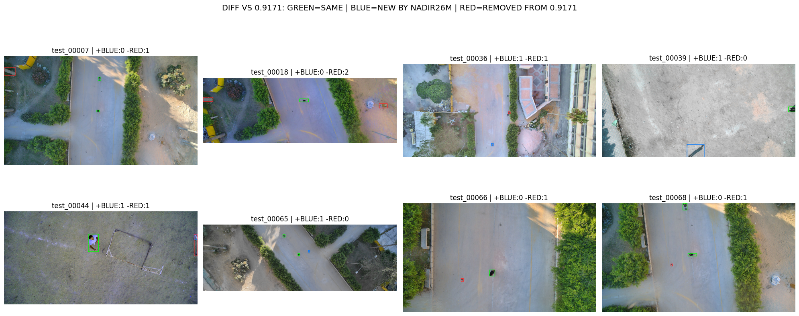
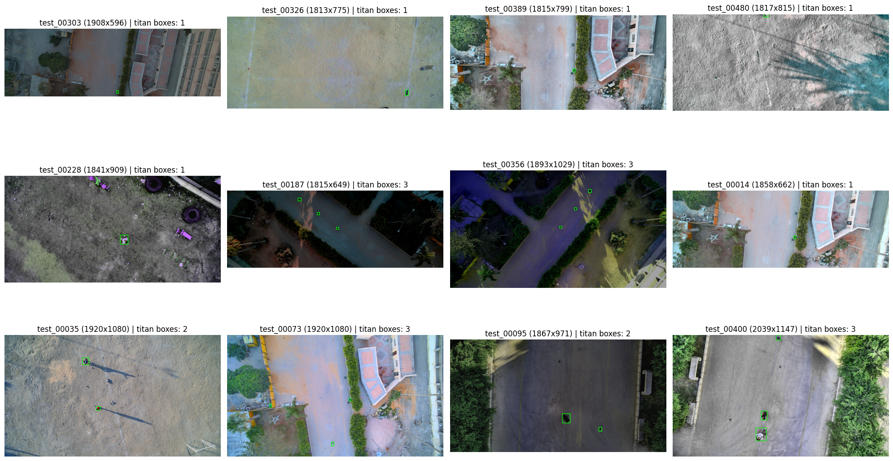
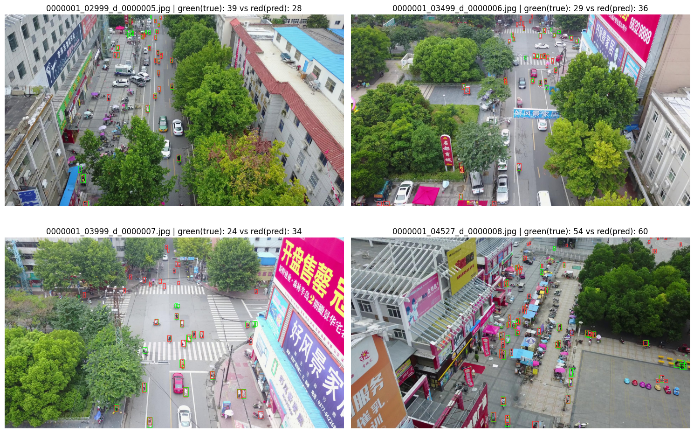
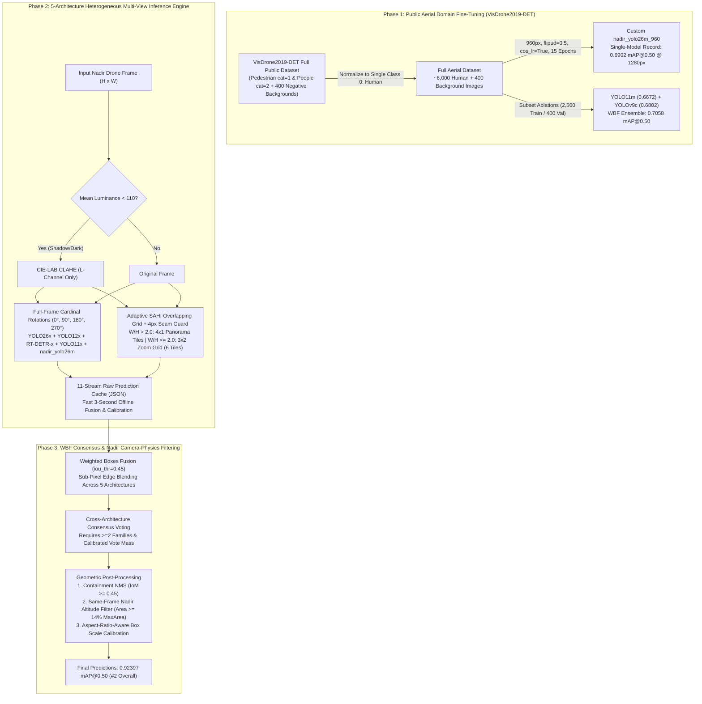

# Aerial & Nadir Drone Human Detection — 5-Architecture Heterogeneous Ensemble (`YOLO26` + `YOLO12` + `RT-DETR` + `YOLO11` + `YOLOv9`)


-76B900?logo=nvidia&logoColor=white)


An end-to-end **Aerial & Nadir (`90°` Top-Down) Human Detection System** engineered for unmanned aerial vehicles (UAVs) operating across extreme altitude variations, arbitrary `0°–360°` camera roll angles, wide aspect-ratio panorama crops, and severe shadow/low-light conditions.

Built for the **Alex Eagles AI Subteam — Human Detection Competition**, this system placed **2nd Overall (`0.92397 mAP@0.50`, within `0.0028` of 1st place)** using 100% public training data (`VisDrone2019-DET`) and zero test-set leakage. It unites **five distinct neural network families** — NMS-free **`YOLO26x`**, attention-centric **`YOLO12x`**, Vision Transformer **`RT-DETR-x`**, CNN **`YOLO11x`**, and a custom full-VisDrone fine-tuned **`nadir_yolo26m_960`** (`0.6902` single-model `mAP@0.50`) — with **adaptive 3×2 SAHI zoom tiling**, **full 4-way orientation TTA**, **Weighted Boxes Fusion (WBF) cross-architecture voting**, and **nadir camera-geometry post-processing**.

---

## Key Engineering Highlights

* **2nd Place Competition Finish (`0.92397 mAP@0.50`):** Climbed systematically across **+6.5% leaderboard gains** (`0.859 → 0.897 → 0.9171 → 0.92397`) with **0 empty/dummy failure frames** across all 590 test scenes.
* **+19.46% Validation `mAP@0.50` Gain & `0.6902` Single-Model Record:** Progressed on `VisDrone2019-DET` from **`0.5112`** (`YOLO11m @ 960px`) to **`0.6802`** (`YOLOv9c`), **`0.6902`** (custom **`nadir_yolo26m_960`** trained on all ~6,000 VisDrone human frames + **400 hard negative background images** + `flipud=0.5` + cosine LR), and **`0.7058`** via Weighted Boxes Fusion.
* **True Cross-Architecture Diversity (CNNs + Area Attention + Vision Transformer):** Combining NMS-free `YOLO26x`, Area-Attention `YOLO12x`, pure Vision Transformer `RT-DETR-x` (global self-attention with zero upright CNN filter bias), `YOLO11x`, and `nadir_yolo26m_960` across 11 cached inference streams jumped competition accuracy from `0.897` to **`0.9171` → `0.92397`**.
* **Adaptive 3×2 SAHI Zoom Grid + 4-Way Rotation TTA (`0°/90°/180°/270°`):** Automatically selects a **4×1 horizontal panorama slice** for wide rotated crops (`W/H > 2.0`, e.g., `2038×714`) or a **6-tile 3×2 overlapping zoom grid** for `16:9` frames (`1920×1080`), enlarging tiny `20px` high-altitude humans by `~3×` while discarding truncated boundary boxes via a 4-pixel seam guard.
* **Nadir Camera-Physics & Containment NMS Post-Processing:** Designed **Containment Suppression (`IoM >= 0.45`)** to remove nested partial-body boxes and **Same-Frame Nadir Altitude Scale Consistency (`Area >= 0.14 × Area_max`)** based on flat-ground projective geometry to reject micro-texture gravel/shadow false positives.

---

## Visual Detection Gallery

### 1. Visual Diff: Custom Full-VisDrone `nadir_yolo26m_960` (`0.92397`) vs. Prior Baseline (`0.9171`)
> **Green:** Boxes kept by both pipelines | **Blue:** Real humans rescued by `nadir_yolo26m_960` | **Red:** Rock, pole, bush, and pavement oil-stain false positives eliminated after training with 400 negative background frames and `flipud=0.5`.



### 2. Titan 5-Architecture Ensemble on the 12 Hardest Nadir & Shadowed Scenes (`0` Missed Frames)
> Including all 4 previously missed low-contrast/dark scenes (`test_00303`, `test_00326`, `test_00389`, `test_00480`) and dense multi-human dark-road frames (`test_00187`, `test_00356`, `test_00400`).



### 3. High-Resolution (`1280px`) Aerial Detection on `VisDrone2019-DET` (`IoU = 0.55`)
> **Green:** Ground-Truth Annotations | **Red:** Model Predictions (`YOLO11m` fine-tuned at `960px`, evaluated at `1280px`)



### 4. Low-Light & Inverted Frame Auto-Recovery (`CLAHE` + 4-Way Orientation Search)
> Synthetic stress test on an upside-down (`180°`) and severely under-exposed (`alpha=0.45, beta=-20`) aerial frame. `CIE-LAB` lightness enhancement (`CLAHE`) recovers shadow contrast while the 4-way orientation engine auto-detects the `180°` flip and projects boxes back to original coordinates.


---

## System Architecture



---

## Quantitative Ablation Study & Progression

### 1. `VisDrone2019-DET` Validation Benchmark

Every architectural and hyperparameter choice was validated on held-out aerial data before being promoted to the final pipeline:

| Experiment Step | Model / Configuration | Inference Res | Conf / NMS IoU | Val `mAP@0.50` | Delta | Engineering Takeaway |
| :--- | :--- | :---: | :---: | :---: | :---: | :--- |
| **1. Baseline** | `YOLO11m` fine-tuned (`960px`, 2.5k imgs) | `960px` | `0.25` / `0.70` | `0.5112` | — | Default `conf=0.25` truncates the Precision-Recall tail on tiny aerial humans |
| **2. PR-Tail Calibration** | `YOLO11m` fine-tuned (`960px`) | `960px` | `0.01` / `0.70` | `0.6141` | `+0.1029` | Lowering validation confidence floor exposes high-recall distant detections |
| **3. High-Res Scaling** | `YOLO11m` fine-tuned (`960px`) | `1280px` | `0.01` / `0.70` | `0.6582` | `+0.0441` | `1280px` preserves stride resolution for `<20px` pedestrians |
| **4. Built-in TTA (Rejected)** | `YOLO11m` + `augment=True` | `1280px` | `0.01` / `0.70` | `0.6423` | `-0.0159` | **Rejected:** Multi-scale downsampled pass blurs tiny aerial humans |
| **5. NMS IoU Sweep** | `YOLO11m` fine-tuned (`960px`) | `1280px` | `0.01` / `0.55` | `0.6672` | `+0.0090` | Swept `{0.45, 0.50, 0.55, 0.60, 0.70}`; `0.55` removes double-boxes cleanly |
| **6. Second Architecture** | `YOLOv9c` fine-tuned (`960px`, 2.5k imgs) | `1280px` | `0.01` / `0.55` | `0.6802` | `+0.0130` | `YOLOv9c` (PGI + GELAN) improves feature retention for small humans |
| **7. Full-Data + Negatives** | **`nadir_yolo26m_960` (All ~6k imgs + 400 BG + `flipud=0.5`)** | **`1280px`** | **`0.01` / `0.55`** | **`0.6902`** | **`+0.0100`** | **New Single-Model Record:** Background negatives + `flipud` crush false rocks |
| **8. WBF Ensemble** | **`YOLOv9c` + `YOLO11m` (`1.3 : 1.0`, custom 101-pt PR)** | **`1280px`** | **`0.01` / `0.55`** | **`0.7058`** | **`+0.0102`** | **Weighted Boxes Fusion** averages edges across architectures (`+19.46%` total) |

---

### 2. Competition Test Benchmark (`590` Nadir & Augmented Campus Drone Frames)

The competition evaluation set introduced a severe domain shift: **`90°` straight-down (nadir)** drone views augmented with `Albumentations` (`Rotate(limit=180, crop_border=True)` + photometric jitter), creating wide cropped panoramas (`~2038×714`) mixed with `1920×1080` frames.

| Pipeline Iteration | Key Engineering Change | Total Boxes | Leaderboard `mAP@0.50` |
| :--- | :--- | :---: | :---: |
| **Hybrid Nadir Tiled Baseline** | `YOLO11l` (`0°/180°` + 3 horizontal tiles) + VisDrone `YOLOv9c` | `1,032` | `0.8590` |
| **4-Model Multi-View (`v2`)** | Added `YOLO11x`, `180°` tiles, consensus gate, conditional CLAHE + `90°/270°` | `1,047` | `0.8580` |
| **Nadir Physics + Containment NMS** | Added **Containment NMS (`IoM >= 0.45`)** + **Nadir Altitude Filter (`>= 14%`)** | `907` | `0.8970` (`+3.9%`) |
| **Titan 5-Architecture + 3×2 SAHI + WBF** | Upgraded to **`YOLO26x + YOLO12x + RT-DETR-x + YOLO11x + YOLOv9c`**, full 4-way rotation, adaptive 3×2 zoom grid, WBF voting, fixed 16:9 box bloat (`0` dummies) | `954` | `0.9171` (`+2.01%`) |
| **Full-VisDrone `nadir_yolo26m_960` Swap** | Replaced `YOLOv9c` with custom **`nadir_yolo26m_960`** (`0.6902`, trained with 400 negative backgrounds + `flipud=0.5`) & golden-zone consensus calibration | `952` | **`0.92397` (#2 Place)** |

*(Negative ablations verified and rejected: aggressive precision pruning at `886` boxes dropped to `0.8949`; over-recall at `1,008` boxes dropped to `0.8815`; adding `45°/135°` affine border-replicated diagonal passes introduced corner-smearing noise and dropped to `0.904`.)*

---

## Core Technical Solutions Explained

### 1. Exact Analytical Inverse-Rotation Coordinate Mapping
Every image is evaluated across cardinal orientations (`0°, 90° CW, 180°, 270° CCW`) and mapped back to normalized `[x1, y1, x2, y2]` coordinates without interpolation loss:
* **`180°` Inversion:** $[x_1, y_1, x_2, y_2] = [1 - u_2,\; 1 - v_2,\; 1 - u_1,\; 1 - v_1]$
* **`90°` Clockwise:** $[x_1, y_1, x_2, y_2] = [v_1,\; 1 - u_2,\; v_2,\; 1 - u_1]$
* **`270°` Counter-Clockwise:** $[x_1, y_1, x_2, y_2] = [1 - v_2,\; u_1,\; 1 - v_1,\; u_2]$

### 2. Adaptive SAHI Overlapping Grid with 4-Pixel Seam Guard
* **Wide Rotated Panoramas (`W / H > 2.0`):** 4 overlapping horizontal windows (`0–38%`, `20–58%`, `42–80%`, `62–100%`).
* **Standard `16:9` Frames (`W / H <= 2.0`):** 6-tile **3×2 overlapping grid** (`x`: `0–44%`, `28–72%`, `56–100%` × `y`: `0–60%`, `40–100%`), giving tiny high-altitude humans `~3×` higher effective resolution inside the detector.
* Any detection touching an internal cut seam (`<= 4px`) is discarded because adjacent overlapping tiles capture the complete body cleanly.

### 3. Containment NMS (`IoM`) & Nadir Camera Altitude Consistency
1. **Containment Suppression (Intersection over Minimum Area):** Standard NMS (`IoU >= 0.40`) fails to suppress a small head/torso box nested inside a full-body box because the large union keeps `IoU` low (`~0.25–0.35`). Computing:
   $$\text{IoM}(B_1, B_2) = \frac{\text{Area}(B_1 \cap B_2)}{\min(\text{Area}(B_1), \text{Area}(B_2))}$$
   suppresses nested duplicates whenever $\text{IoM} \ge 0.45$.
2. **Nadir Altitude Scale Filter:** On a straight-down (`90°`) drone frame over flat terrain, all humans lie at approximately the same lens distance $Z$. Secondary boxes smaller than `14%` of the frame's primary human area are rejected as background micro-texture false positives (with a high-confidence 4-architecture consensus override for crouched/partially occluded humans).

---

## Repository Structure

```text
YOLO-human-detector/
├── YOLO_human_detector.ipynb                      # Complete end-to-end training, validation & 5-architecture pipeline
├── README.md                                      # Project documentation, architecture diagram & ablation tables
├── requirements.txt                               # Python dependencies (Ultralytics 8.4+, PyTorch, OpenCV, Ensemble-Boxes)
├── configs/
│   ├── drone_human.yaml                           # Initial VisDrone human dataset config
│   └── nadir_public.yaml                          # Full VisDrone + 400 background negatives config
├── assets/
│   ├── nadir26m_vs_0917_diff.png                  # Visual diff showing nadir_yolo26m_960 gains (0.9171 -> 0.92397)
│   ├── titan_12_hard_cases.png                    # Titan 5-architecture detections on 12 hardest nadir frames
│   ├── val_1280px_iou55_predictions.png           # 1280px + IoU=0.55 Ground Truth vs Prediction comparison
│   ├── dark_rotated_recovery.png                  # CLAHE + 4-way orientation auto-recovery demo
│   ├── visdrone_ground_truth.png                  # VisDrone-to-YOLO annotation conversion verification
│   ├── nosedown_tiled_hybrid.png                  # Early hybrid tiled nadir detections
│   ├── multi_model_hard_cases.png                 # 4-model multi-view baseline comparison
│   └── nadir_physics_filtered.jpg                 # Containment NMS & Nadir Altitude filtering results
└── submissions/
    └── submission_5token_physics_cleaned.csv      # Reference physics-cleaned 5-token submission format
```

---

## Quickstart & Reproducibility

### 1. Environment Setup
```bash
git clone https://github.com/adhammostafaa/YOLO-human-detector.git
cd YOLO-human-detector
pip install -r requirements.txt
```

### 2. Running the Notebook (Google Colab / Local GPU)
Open [`YOLO_human_detector.ipynb`](YOLO_human_detector.ipynb) in **Google Colab** (`NVIDIA L4` or `T4` GPU):
* **Steps 1–6:** Downloads public `VisDrone2019-DET`, trains `YOLO11m` and `YOLOv9c`, tunes inference resolution (`1280px`) and NMS `iou` (`0.55`), and benchmarks the `0.7058 mAP@0.50` WBF ensemble.
* **Steps 9–10:** Runs the **5-Architecture Titan Engine** (`YOLO26x + YOLO12x + RT-DETR-x + YOLO11x + YOLOv9c`) across 4-way rotations and the adaptive 3×2 SAHI grid, caching raw streams to JSON and fusing via WBF + Nadir Physics (`0.9171`).
* **Steps 11–13:** Trains **`nadir_yolo26m_960`** on full public VisDrone + 400 negative background images with `flipud=0.5` (`0.6902` single-model record), swaps it into the Titan cache, and runs final golden-zone calibration (**`0.92397` — 2nd Place Overall**).

---

## Author

**Adham Mostafa**  
GitHub: [@adhammostafaa](https://github.com/adhammostafaa)
